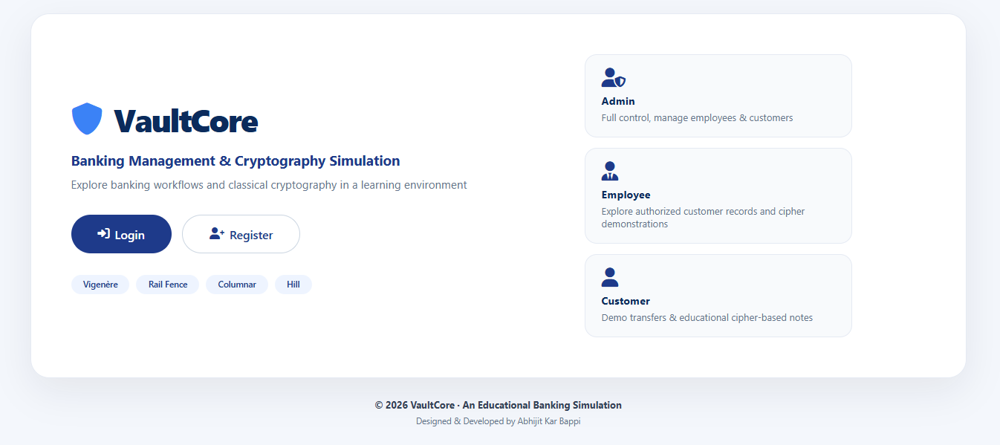
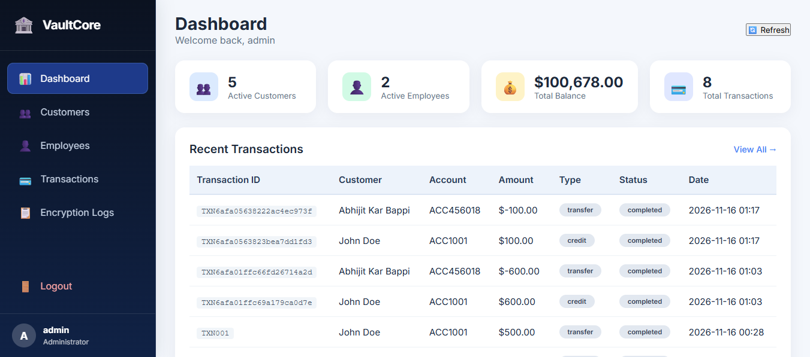
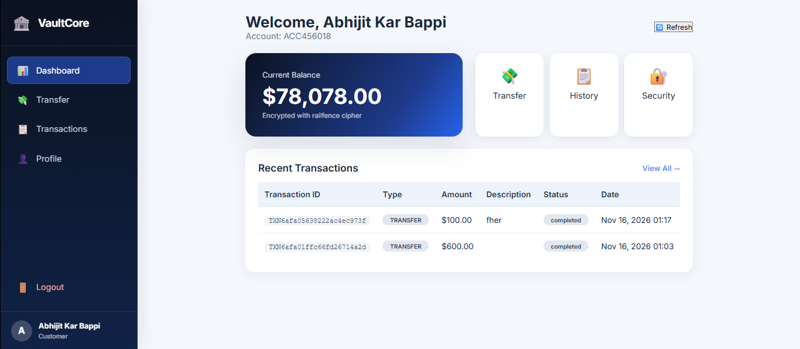
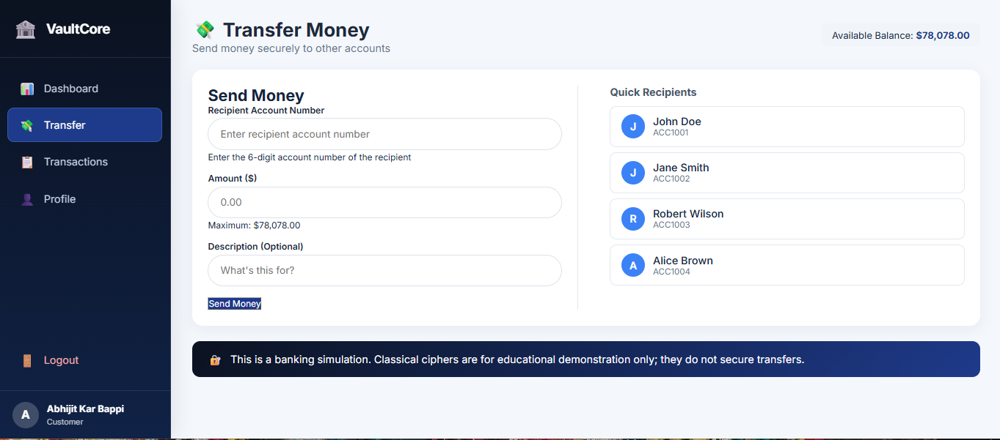
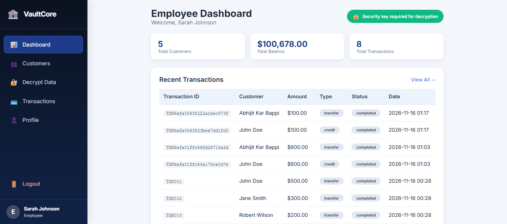

# VaultCore

**Educational Banking Management & Classical Cryptography Simulation**  
**Current documented version:** v1.4.1

VaultCore is a PHP/MySQL classroom project demonstrating role-based dashboards, simulated bank accounts and transfers, and historical/classical cipher exercises. **It is not a real bank or a production-ready security system.** Do not use real funds, real customer records, or confidential information.

## Screenshots

Screenshots from the local VaultCore v1.4 demonstration. The v1.4.1 update focuses on backend security controls rather than visual redesign. All displayed accounts and transactions should be demonstration data only.

### Homepage


### Admin dashboard


### Customer dashboard


### Simulated money transfer


### Employee dashboard


> **Cryptography modules:** Vigenère, Rail Fence, Columnar Transposition, and Hill are backend PHP modules, not standalone demonstration screens. Classical ciphers are included for learning, not for protecting real financial data.

## Main features

- **Admin:** Customer and employee management, transaction overview, cipher activity logs.
- **Employee:** Customer lookup and classical cipher decryption demonstration.
- **Customer:** Registration, account overview, simulated transfers, transaction history, profile.
- **Access controls:** Role-based authentication, password hashing, session handling, and CSRF protection on supported forms.
- **Educational cryptography:** Vigenère, Rail Fence, Columnar Transposition, and Hill cipher modules.

## What's updated in v1.4.1

This maintenance update focuses on employee-management and decryption workflows:

- Rechecks employee account status during protected requests to restrict access for disabled employees.
- Requires at least 12 characters for newly created employee passwords and security keys.
- Uses stronger random employee identifiers.
- Avoids exposing detailed database errors to users during employee creation.
- Escapes customer-identifying information in decryption results.
- Records failed decryption attempts without logging submitted security keys.
- Applies a **session-based** limit of five failed decryption attempts per 15-minute window.

These controls improve the classroom demonstration but **do not constitute a complete security audit**. Session-based throttling can be bypassed with a new session; login-wide rate limiting and other production controls remain outside the project's scope.

## Tech stack

- **Backend:** PHP
- **Database:** MySQL with PDO
- **Frontend:** HTML, CSS, JavaScript
- **Local development:** XAMPP (Apache and MySQL)

## Local installation (XAMPP)

1. Back up any existing `bank-3` directory and export its MySQL database.
2. Clone this repository into `C:\xampp\htdocs\bank-3` (Windows), or copy it to your local server's web root.
3. Start Apache and MySQL in XAMPP.
4. In phpMyAdmin, import `database.sql` into a **new, disposable database**. Do **not** re-import it over an existing populated database; it contains table creation and demo INSERT statements.
5. Configure the local connection in `database.php` (database `secure_bank`, host `localhost`, and your local MySQL username/password). Never commit real credentials.
6. Open `http://localhost/bank-3/` and test the admin, employee, and customer roles.

### Seed accounts (local demo only)

| Role | Identifier | Password |
| --- | --- | --- |
| Admin | `admin` | `password` |
| Employee | `sarah@securebank.com` | `password` |
| Customer | `john@email.com` | `password` |

Additional seeded users and demonstration employee security keys are included in `database.sql`. These deliberately weak credentials are suitable **only for an isolated local classroom environment**. Do not expose the seeded application to the public internet.

## Safety and scope

- Classical ciphers are **not modern encryption**. Customer cipher keys are stored in the demonstration database and must never protect real secrets.
- VaultCore has not been independently audited, penetration-tested, or validated for real financial transactions.
- Simulated transfers use a conditional balance update inside a database transaction; concurrency and failure recovery should be tested in the target MySQL environment.
- Older databases may contain plaintext `encryption_logs.key_used` values. Back up and review existing data before redacting these records; see `RELEASE_NOTES_V1.4.md`.
- The v1.4.1 decryption throttle is session-based, not a substitute for account/IP-level abuse protection. Comprehensive login rate limiting and production security controls are not implemented.
- Use VaultCore only on `localhost` or in a restricted private test environment.

## Project structure

```text
admin/          Admin dashboards and management pages
auth/           Authentication and registration
customer/       Customer account and transfer pages
employee/       Employee dashboard and decryption pages
css/            Stylesheets
js/             Browser scripts
screenshots/    README screenshots
database.php    PDO connection and shared helpers
database.sql    Database schema and demonstration seed data
session.php     Session, authorization, and CSRF helpers
*.php           Educational classical cipher modules and entry points
```

## Documentation and version history

- `RELEASE_NOTES_V1.4.md` — Initial v1.4 release details and manual testing notes.
- `VAULTCORE_CHANGELOG.md` — Project change history (may need a v1.4.1 entry if not yet updated).
- **v1.4.1** — Employee access and decryption security maintenance update, summarized above.

## Developer

**Abhijit Kar Bappi** · [GitHub](https://github.com/devbybappi)
